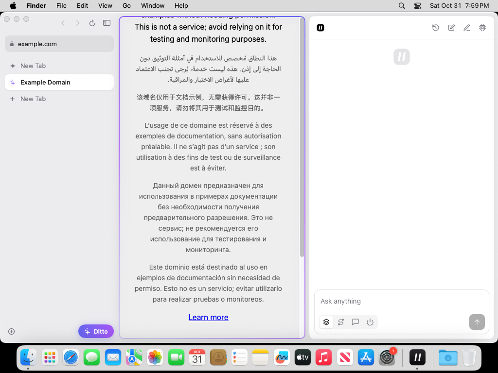
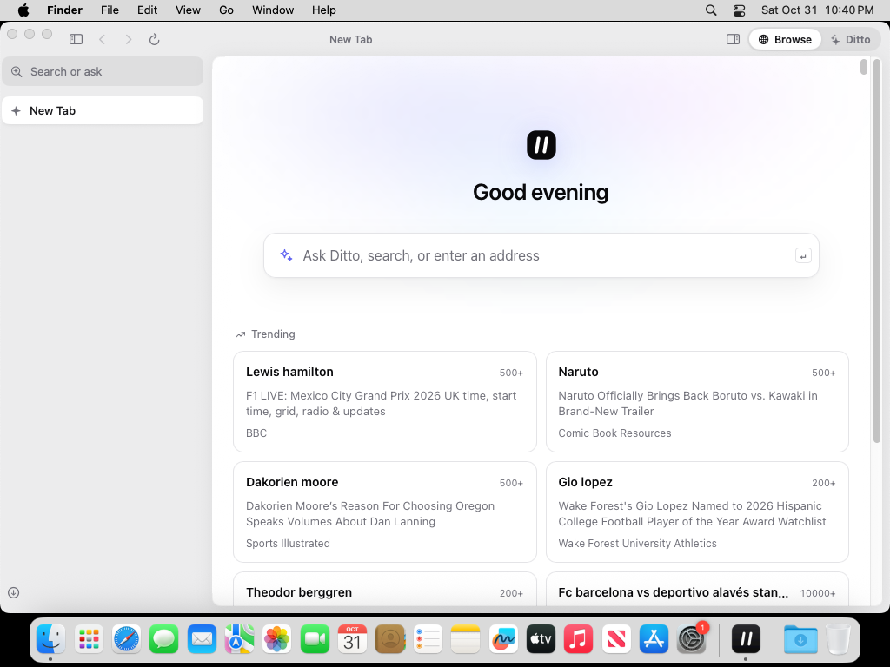

# Ditto

A fast, minimal browser for the Mac with a browsing agent built in. Small
open-weight models run **on your Mac**: they read pages, navigate, fill
forms and answer with sources. Nothing leaves your Mac, and you can turn
every model off.

## Download

| Platform | Download |
| --- | --- |
| macOS 14+, Apple silicon | [**Ditto-mac-arm64.dmg**](https://github.com/webbeep/Ditto/releases/latest/download/Ditto-mac-arm64.dmg) |
| macOS 14+, Intel | [**Ditto-mac-x64.dmg**](https://github.com/webbeep/Ditto/releases/latest/download/Ditto-mac-x64.dmg) |

Open the DMG and drag **Ditto** to **Applications**. Ditto is not yet signed
with an Apple Developer ID, so macOS refuses to open it the first time.
Allow it once in **Terminal**:

```sh
xattr -dr com.apple.quarantine /Applications/Ditto.app && open /Applications/Ditto.app
```

All releases: <https://github.com/webbeep/Ditto/releases>. Releases before
v0.3.0 were Chromium-based previews.

## The browser



Ditto is a native Mac app (SwiftUI) on WebKit, Safari's engine: a small
app, quick to start, light on memory and battery.

- **One quiet window.** Tabs, favourites and the address live in a sidebar;
  the page sits in a card; Ditto's panel opens on the right. Hide the
  sidebar (⌘S) for the page alone. Closing the last tab leaves you a new
  one, not an empty desktop.
- **One field for everything (⌘T, ⌘L).** Type an address to open it, a
  question to ask Ditto, or anything to search Google. Search suggestions,
  open tabs, bookmarks and history match as you type; arrow keys and ↩
  pick.
- **A new tab page that learns you.** Your most visited sites, what is
  trending in your region, and, picked out first, the trends that match
  what you read. The matching runs on your Mac from your history and
  Ditto's notes; nothing about you is sent.

  
- **Light on memory.** Tabs you have not looked at for 20 minutes sleep
  (their page is dropped, their place and history kept) and wake when you
  click them; under memory pressure they sleep at once. Tabs playing sound
  stay awake and show a speaker you can click to mute. Restored tabs load
  only when you open them.
- **Shield, in every tab.** Ad networks' requests are blocked (a WebKit
  content blocker), ad slots are hidden, and a click that an invisible layer
  over the page would catch (a common trick to open an ad) goes to what you
  clicked on. YouTube ads are skipped as soon as YouTube offers *Skip*, with
  a real click. Ads that cannot be skipped play as usual.
- **Move from Chrome in one click.** *Ditto → Import from Chrome* (or the
  new tab page) brings over the bookmarks and recent history of your
  last-used Chrome profile and offers to sign in to the same Google account.
- **Keyboard first.** ⌘T new tab, ⌘W close, ⇧⌘T reopen, ⌘1–9 switch, ⌘J
  Ditto, ⌘S sidebar, ⌘D bookmark, ⌘F find, ⌘[ / ⌘] back and forward.

Your Google account works as a normal web sign-in (Gmail, YouTube, Drive).
Chrome Sync is not available outside Google Chrome; see
[docs/GOOGLE_ACCOUNT.md](docs/GOOGLE_ACCOUNT.md).

## The agent

Two kinds of model, each doing what it is good at:

| Role | Job | Models (Hugging Face) |
| --- | --- | --- |
| **Decider** | Every navigation step, in one forward pass with calibrated probabilities: *is the goal reached? is this page relevant? which link or field next?* | LiquidAI **d1** (`d1-omni-600M`, `d1-2B`, `d1-Omni-2B`), Amazon **strands-decider** (`2B-qwen3.5`, `E2B-gemma4`) |
| **Responder** | Plans the task, takes over steps the decider is unsure about, and writes the answer from page text, with citations | LiquidAI **LFM3** (`1.7B`, `Omni-2B`), **Qwen3.5** (`2B`, `4B`, `9B`), LFM2.5 `8B-A1B` |

- **Starts small:** 8 GB Macs get LFM3 1.7B and d1 Omni 600M (about 2.4 GB
  of RAM together); 16 GB+ Macs get Qwen3.5 4B and d1 2B. The *Models*
  panel downloads, swaps and deletes models; *Off* stops the runtime.
- **Works in its own tab, in view:** Ditto browses in a tab of its own,
  opened on the page you are on, while you keep yours. The panel shows that
  tab live, a glow marks it while Ditto works, and one click puts it in
  the window to watch or take over. Nothing in Ditto's tab plays by itself,
  so a video it reads stays silent.
- **Answers it can point to:** Ditto stops when the answer is on the page:
  the LLM reads it off together with the sentence that states it, and that
  sentence must really be there. Pages that only look right are passed
  over, and every answer cites its pages.
- **Keeps watch for you:** "tell me when this drops below $40", "watch
  this page for new episodes every 2 hours". Ditto reads the page again on
  that schedule (hourly unless you say otherwise), in its own tab, even
  with the panel closed, and sends a macOS notification when it happens;
  click it to open the page. Amounts are compared exactly, not by the
  model. *Memory* lists what Ditto watches; stop any of them there.
- **Reads what you have open:** "tl;dr", "summarize this video" or "what is
  this page about" works on the open tab, from the video's transcript when
  there is one.
- **Knows you, locally:** notes about your preferences, learned from your
  chats or told ("remember that I prefer metric units"), and the sites your
  tasks end on. *Memory* in the panel lists every note; forget one, all, or
  turn learning off.
- **Uses your bookmarks and history:** for "reorder from my usual store" or
  "that article I read", it can start on one of your own pages; it never
  makes up an address.
- **Does tasks with your signed-in sessions, with you in charge:** its tab
  shares your cookies, so the sites you are signed in to know it is you. It
  clicks and types with real input. It never types passwords or card
  details: when a page needs them it hands you the tab.
  Anything that commits you (buying, paying, sending, subscribing,
  deleting) waits for **Approve**.
- **Does not fall for ads:** ads are hidden from the models, invisible
  layers cannot catch its clicks, and a link a script redirects to an ad is
  undone.
- **Contained:** the model runtime listens only on a random loopback port
  with a per-launch key the app holds. The agent pages talk to the app
  through a bridge that answers only Ditto's own pages, and the agent can
  use six page commands on web pages only.

Under the hood: one bundled [llama.cpp](https://github.com/ggml-org/llama.cpp)
`llama-server` (v0.8.0, Metal) in router mode serves the LLMs (OpenAI chat
API) and the d1 deciders (`/v1/systemone`). Strands deciders run in the
optional sidecar (`scripts/install-strands-decider.sh`).

How it fits together: [docs/ARCHITECTURE.md](docs/ARCHITECTURE.md).

## Build

```sh
cd agent && npm ci && cd ..
scripts/build-app.sh arm64 v0.4.0      # or x86_64; needs Xcode 16+ and Node 22
open build/app-arm64/Ditto.app
scripts/smoke-app.sh build/app-arm64/Ditto.app   # the app's self-test
```

A build takes a few minutes. [`release`](.github/workflows/release.yml)
builds both architectures on GitHub's macOS runners, runs the self-test
with screenshots, and publishes the DMGs.

### Agent development (no Mac needed)

```sh
cd agent && npm ci && npm test
```

The tests run the agent, the panel and new tab pages (with a stand-in for
the app), and the shield scripts in a real headless Chromium, against a mock
model runtime that speaks llama-server's APIs.

## What is verified

- **76 automated tests** (`cd agent && npm test`): the agent in all modes;
  reading videos and long pages; dropdowns, cookie walls, ads, overlays and
  hijacked links; memory, bookmarks and the approval gate; watches (set up
  from a chat, checked on schedule, told once); the panel and new tab page
  (suggestions, trending, for you); the shield and YouTube-skip scripts.
- **A scored task suite** (`npm run eval`): 16 tasks graded on the answer,
  where the agent ends and what it cites; at least 90% on every push, and
  with real models on a Mac in [`eval`](.github/workflows/eval.yml).
- **Every release build** runs the app's self-test on a Mac: the new tab
  page and its bridge, the agent panel, page control on a live site with a
  real click, the shield, the bundled model runtime, a question answered by
  the agent in its own tab, a watch set up from the panel, a tab put to
  sleep and woken, and closing every tab.
- **Not yet:** releases are not signed with an Apple Developer ID or
  notarized; passwords are not saved by Ditto yet (sites keep you signed in
  as usual).

## Roadmap

- Saved passwords and autofill.
- iPhone and iPad (the same WebKit app).
- Screenshot input to the decider for image-heavy pages.

## License

Ditto's own code is BSD-3-Clause. llama.cpp keeps its license. Models have
their own licenses (LFM Open License v1.0, Apache-2.0, Gemma terms), shown
in the Models panel before download.
